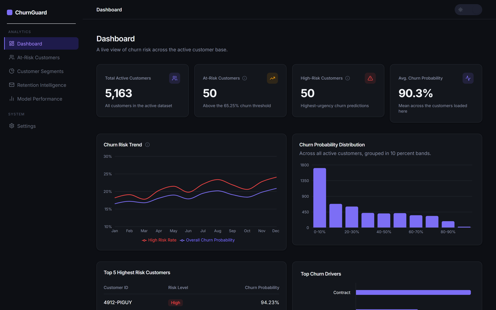
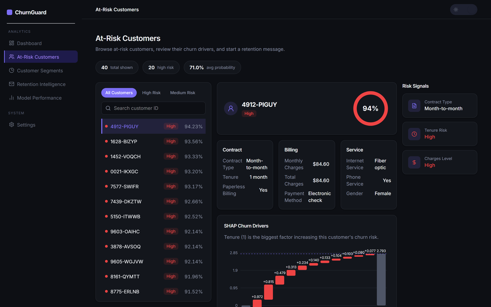
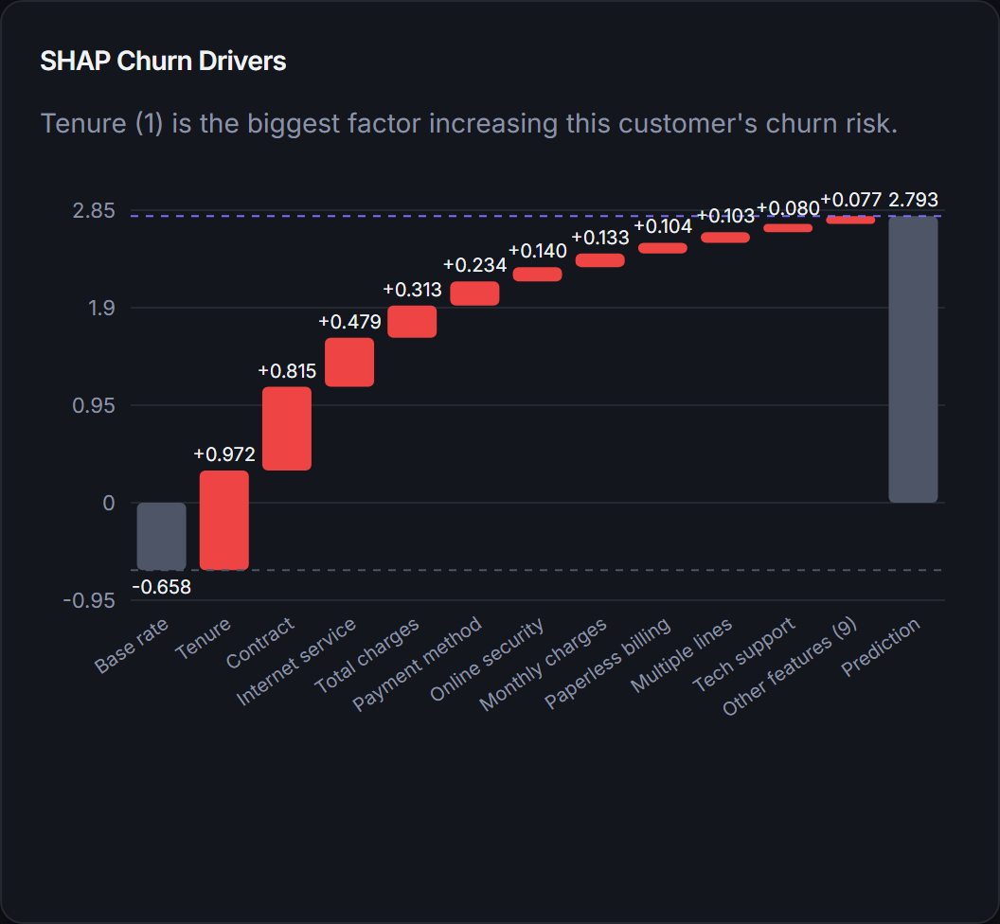
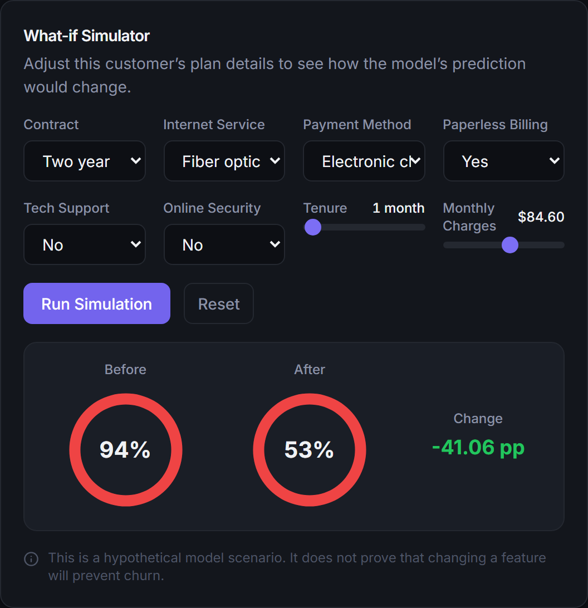
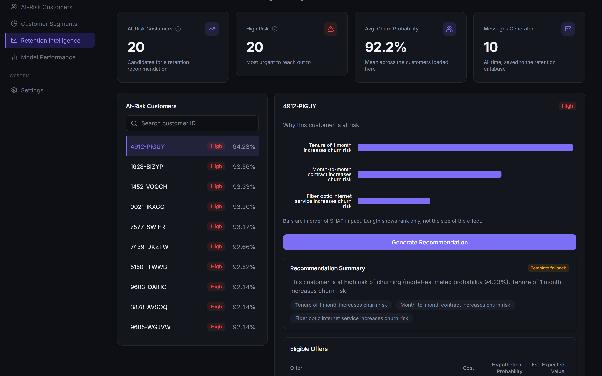
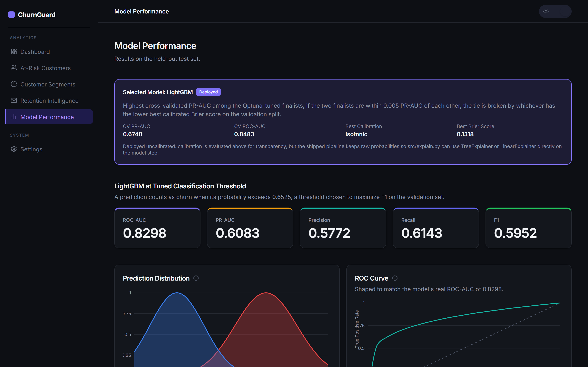
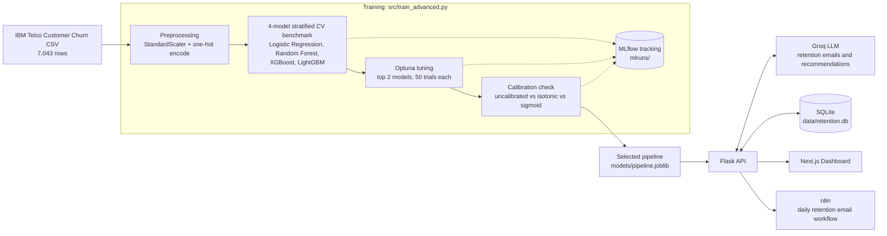

# ChurnGuard: AI-Powered Churn Prediction and Retention Platform

ChurnGuard is an end-to-end churn management platform built on the IBM Telco Customer
Churn dataset. It benchmarks four machine learning models with cross-validation, tunes the
top two with Optuna, checks their probability calibration, and automatically selects a final
model using a documented rule. The deployed model powers a Flask API that explains every
prediction with SHAP, lets a user simulate hypothetical changes to a customer's plan, and
generates grounded, LLM-written retention recommendations ranked by estimated expected
value. A Next.js dashboard surfaces all of this, and an n8n workflow sends daily retention
emails automatically.


## Live Demo

- Dashboard (Vercel): `TODO - add your Vercel deployment URL here`
- API (Render): `TODO - add your Render deployment URL here`

## Screenshots

Captured from the running app (dark theme, 1440x900) and saved in `docs/screenshots/`.

| Dashboard | At-Risk Customers |
| --- | --- |
|  |  |

| SHAP Waterfall | What-if Simulator |
| --- | --- |
|  |  |

| Retention Intelligence | Model Performance |
| --- | --- |
|  |  |

## Key Features

- Four-model benchmark (Logistic Regression, Random Forest, XGBoost, LightGBM) with
  stratified 5-fold cross-validation, Optuna hyperparameter tuning, and an automatic,
  documented model selection rule.
- Probability calibration comparison (uncalibrated vs isotonic vs sigmoid) with Brier
  scores, reported for transparency.
- Two classification thresholds: the standard F1-optimal threshold and a business-cost
  threshold that maximizes expected net savings from a configurable cost model.
- Full MLflow experiment tracking (params, metrics, calibration curves, threshold curves,
  and the registered model) in a local file store.
- Per-customer SHAP waterfall explanations showing exactly how each feature pushed a
  prediction up or down from the model's base rate.
- An interactive what-if simulator: edit a customer's contract, tenure, charges, and service
  add-ons and see the hypothetical new churn probability and risk level.
- Grounded, LLM-generated retention recommendations: a curated offer catalog with
  eligibility rules and model-estimated expected value, ranked, then handed to Groq under a
  strict system prompt, validated with Pydantic, and backed by a deterministic fallback.
- A daily n8n workflow that emails retention messages for the top at-risk customers and logs
  every send to Google Sheets.

## Architecture



## Tech Stack

| Layer | Technology |
| --- | --- |
| API | Flask, Gunicorn, Flask-CORS |
| Machine learning | scikit-learn, XGBoost, LightGBM, SHAP |
| Hyperparameter tuning and tracking | Optuna, MLflow |
| LLM | Groq (`openai/gpt-oss-20b`) |
| Validation | Pydantic |
| Storage | SQLite (retention recommendation history) |
| Frontend | Next.js 16, React 19, TypeScript, Tailwind CSS v4, Framer Motion, Recharts |
| Automation | n8n (Docker) |
| Deployment | Docker, Render (API), Vercel (dashboard) |

## ML Methodology

**Dataset**: the IBM Telco Customer Churn dataset, 7,043 customers and 21 columns, with a
26.54% churn rate (5,174 retained, 1,869 churned). Rows with a blank `TotalCharges` are
dropped and categorical columns are one-hot encoded with the first level dropped, exactly as
in the original notebook, so the deployed API and the training script share one encoding.

**Split and leakage prevention**: a stratified 70/15/15 train/validation/test split
(4,922/1,055/1,055 rows), fixed at `random_state=42`. All preprocessing (the `StandardScaler`
on `tenure`, `MonthlyCharges`, `TotalCharges`) is fit only on the training fold inside a
scikit-learn `Pipeline`, both during cross-validation and for the final model, so no
validation or test row ever influences a preprocessing statistic. The test set is scored
exactly once, after model selection and threshold tuning are both finished.

**Benchmark**: four models are cross-validated with stratified 5-fold CV on the training
set alone, recording ROC-AUC, PR-AUC, precision, recall, F1, fit time, and inference time per
model (see Results below).

**Tuning**: the two models with the highest baseline PR-AUC (Logistic Regression and
LightGBM) are tuned with Optuna, 50 trials each, a fixed random seed, optimizing mean 5-fold
CV PR-AUC, since the classes are imbalanced.

**Calibration**: for each tuned finalist, uncalibrated, isotonic, and sigmoid calibration are
compared by Brier score on the held-out validation split, with the calibration curve data
saved alongside.

**Thresholds**: the F1-optimal threshold is the usual choice, found from the
precision-recall curve on the validation set. A second, business-cost threshold is found by
scanning thresholds from 0.05 to 0.95 and maximizing expected net savings, defined from
`src/business_config.json` as `(probability reduction) * revenue_lost_per_churn - cost_of_contact
- offer_success_rate * cost_of_retention_offer`, summed over the validation set's predicted
positives.

**Model selection rule** (from `models/metrics.json`, `selected_model.rule`):

> Highest cross-validated PR-AUC among the Optuna-tuned finalists; if the two finalists are
> within 0.005 PR-AUC of each other, the tie is broken by whichever has the lower best
> calibrated Brier score on the validation split.

LightGBM and Logistic Regression ended within that tolerance, so LightGBM won on its lower
calibrated Brier score (0.1318 isotonic vs Logistic Regression's 0.1321 sigmoid). The winner
is refit on the full training set and evaluated once on the untouched test set. Every run
(benchmark, tuning, calibration, and the final model) is logged to a local MLflow file store
at `mlruns/`, and the winning pipeline is registered there as `churnguard-model`.

The deployed pipeline keeps its raw, uncalibrated probabilities. Calibration is reported for
transparency, but a `CalibratedClassifierCV` wrapper would hide the underlying tree or linear
model from SHAP's `TreeExplainer` and `LinearExplainer`, so `src/explain.py` detects the
model type at runtime (`coef_` means linear, otherwise a tree ensemble) and explains the
model actually shipped.

## Results

4-model cross-validated benchmark on the training set (`models/metrics.json`,
`model_comparison`):

| Model | ROC-AUC | PR-AUC | Precision | Recall | F1 | Fit time |
| --- | --- | --- | --- | --- | --- | --- |
| Logistic Regression | 0.8476 | 0.6703 | 0.5220 | 0.8066 | 0.6338 | 0.03s |
| Random Forest | 0.8281 | 0.6357 | 0.6470 | 0.4893 | 0.5570 | 0.26s |
| XGBoost | 0.8204 | 0.6215 | 0.5485 | 0.6476 | 0.5938 | 0.16s |
| **LightGBM (selected)** | 0.8321 | 0.6498 | 0.5346 | 0.6996 | 0.6059 | 0.14s |

After Optuna tuning, LightGBM's cross-validated PR-AUC reached 0.6748 (ROC-AUC 0.8483) and
was confirmed as the final model by the selection rule above.

Final test set metrics for the deployed LightGBM pipeline, evaluated once:

| Threshold | Value | Precision | Recall | F1 | ROC-AUC | PR-AUC |
| --- | --- | --- | --- | --- | --- | --- |
| F1-optimal | 0.6525 | 0.5772 | 0.6143 | 0.5952 | 0.8298 | 0.6083 |
| Business-cost | 0.1600 | 0.3657 | 0.9679 | 0.5309 | 0.8298 | 0.6083 |

Confusion matrix at the F1 threshold (test set, 1,055 rows): 649 true negatives, 126 false
positives, 108 false negatives, 172 true positives.

Business-cost threshold optimization used `cost_of_contact=$5`,
`cost_of_retention_offer=$50`, `revenue_lost_per_churn=$777`, `offer_success_rate=35%`
(`src/business_config.json`, placeholders, not measured figures). On the test set, the F1
threshold yields an estimated $40,070.40 in expected net savings, while the business-cost
threshold (which trades precision for recall) yields an estimated $57,025.95.

Note: for backward compatibility with the original API contract, `models/metrics.json` keeps
the legacy key names `xgboost_test_default_threshold`, `xgboost_test_tuned_threshold`, and
`cv_mean_roc_auc.xgboost` even though they now hold the selected model's (LightGBM's) numbers,
not literally XGBoost's. `logistic_regression_test` and `cv_mean_roc_auc.logistic_regression`
are unaffected and remain genuine Logistic Regression results.

## Explainability

Every customer's prediction can be broken down with a SHAP waterfall: a base rate (the
model's expected output), one floating bar per feature showing its signed contribution (red
for features that increase churn risk, blue for features that decrease it), and a final bar
at the model's actual output. Small contributions beyond the top 10 features are folded into
a single "Other features" bucket so the chart stays readable. The underlying explainer is
`TreeExplainer` for tree ensembles or `LinearExplainer` for linear models, chosen automatically
based on the deployed model's type.

The what-if simulator lets you override a customer's contract, tenure, monthly charges,
internet service, payment method, paperless billing, tech support, and online security, then
reruns the same pipeline to show the hypothetical new probability, risk level, and top SHAP
drivers. **This is a hypothetical model scenario. It does not prove that changing a feature
will prevent churn** - it shows what the model would predict under those conditions, nothing
more.

## Retention Intelligence

Retention recommendations are grounded in verified data only: a customer's real profile
fields, their churn probability and risk level, and their top SHAP drivers. A small offer
catalog (`src/retention_offers.json`) defines each retention action's cost, eligibility
rules, and an optional feature override representing the offer in the model's own feature
space (an annual contract upgrade maps to `Contract=One year`, an autopay switch maps to
`PaymentMethod=Credit card (automatic)`, and so on). Every eligible offer with a feature
override is run through the same simulation logic as the what-if simulator to get a
hypothetical new probability, then ranked by an estimated expected value: probability
reduction times revenue lost per churn, minus the offer's cost and the cost of contacting the
customer.

Groq is then prompted with a strict system prompt: use only the provided context, never
invent customer details, offers, discounts, prices, or financial figures, and recommend only
an offer id from the eligible list. The reply is validated with Pydantic against an exact
schema, retried once on any validation failure (invalid JSON, a schema mismatch, an invented
offer id, or an email that breaks the content rules), and replaced by a deterministic
template-based recommendation if Groq fails twice or no `GROQ_API_KEY` is set. Every
recommendation, from either source, is saved to a SQLite database at `data/retention.db`
with the customer id, timestamp, offer id, source, and the full JSON payload.

## API Reference

| Method | Path | Purpose |
| --- | --- | --- |
| GET | `/health` | Liveness check; also reports the deployed model name and threshold |
| POST | `/predict` | Score a raw customer record for churn probability |
| GET | `/customers/at-risk` | Top N active customers by churn probability |
| GET | `/customers/by-risk` | Top N active customers within one risk level (high, medium, low) |
| GET | `/customers/summary` | Aggregate churn risk across the full active customer base |
| GET | `/customers/<id>` | One customer's profile, prediction, and top SHAP reasons |
| GET | `/customers/<id>/shap-waterfall` | Full SHAP waterfall breakdown for one customer |
| GET | `/metrics` | The full contents of `models/metrics.json` |
| GET | `/models/comparison` | Cross-validated metrics for all 4 benchmarked models |
| GET | `/models/calibration` | Brier scores and calibration curves for the tuned finalists |
| GET | `/models/threshold-curve` | Expected savings vs threshold, plus the F1 and business thresholds |
| GET | `/shap/global` | Top 5 global SHAP feature importances |
| POST | `/retention/recommend` | Generate a grounded retention recommendation for one customer |
| GET | `/retention/history` | Recently generated retention recommendations |
| POST | `/retention-message` | Generate a single retention email (used by the n8n workflow) |
| POST | `/simulate` | Run a what-if scenario with feature overrides for one customer |

Example:

```bash
curl http://localhost:5053/health
```

```json
{"status": "ok", "timestamp": "2026-01-01T00:00:00+00:00", "model": "lightgbm", "threshold": 0.6524895334076356}
```

## n8n Automation

`automation/workflow.json` is an n8n workflow that fetches the top 20 at-risk customers,
generates a retention email for each one through `/retention-message`, sends it (to a single
test address, not real customers), and logs the result to a Google Sheet. It runs on a daily
9am schedule or on demand. See `automation/README.md` for the full setup: starting the API on
all interfaces, running n8n in Docker, creating the Google Sheet and OAuth credentials, and
importing the workflow.

## Local Setup

Clone the repo, then from the project root:

```bash
python -m venv venv
# Windows: venv\Scripts\activate | macOS/Linux: source venv/bin/activate
pip install -r api/requirements.txt -r api/requirements-train.txt
```

Train the model (writes `models/pipeline.joblib`, `models/metrics.json`, and MLflow runs
under `mlruns/`):

```bash
python src/train_advanced.py
```

Run the API (reads `api/.env`, copy it from `api/.env.example` first; defaults to port 5053):

```bash
python api/app.py
```

Run the dashboard in another terminal (reads `web/.env.local`, copy it from
`web/.env.example` first; defaults to port 5025):

```bash
cd web
npm install
npm run dev
```

Open the MLflow UI to browse every training run:

```bash
mlflow ui --backend-store-uri file:./mlruns --port 5055
```

## Testing

```bash
cd api
pip install -r requirements.txt -r requirements-train.txt
pytest
```

111 tests pass, covering prediction, explanation, simulation, retention recommendations
(including mocked Groq success, retry, and fallback paths), and every API endpoint.

```bash
cd web
npm run build
```

## Deployment

**API on Render** (Docker web service, free plan):

1. Push this repo to GitHub.
2. In Render, choose "New Blueprint" and point it at the repo; `render.yaml` at the repo
   root defines the `churnguard-api` Docker service, its health check path (`/health`), and
   its environment variables.
3. Set `GROQ_API_KEY` in the Render dashboard (it is marked `sync: false` in `render.yaml`,
   so Render will not store it in the blueprint itself).
4. Leave `ALLOWED_ORIGINS` pointed at your Vercel dashboard URL once you have it, and
   `RETENTION_DB_PATH` as set in `render.yaml`.

**Dashboard on Vercel**:

1. Import the repo into Vercel and set the project's root directory to `web`.
2. Set `NEXT_PUBLIC_API_URL` to your Render API's URL.
3. Deploy. Update `ALLOWED_ORIGINS` on the Render service to match the resulting Vercel URL.

## Limitations

- The dataset is a public, static snapshot (IBM's Telco Customer Churn sample), not a live
  feed, so the model reflects one point in time, not ongoing drift.
- The Dashboard's monthly churn trend charts are illustrative simulated series, not derived
  from live predictions; they are labeled as such in the UI.
- SQLite on Render's free tier is ephemeral: the container's filesystem is not persisted
  across deploys or restarts, so `data/retention.db` and its recommendation history reset
  when the service redeploys.
- Expected values (from both the business-cost threshold and the retention offer ranking)
  are model-based estimates built on configurable cost assumptions, not guarantees of actual
  savings.

## Future Work

- Swap the static CSV for a live data pipeline with scheduled retraining.
- Track real retention outcomes per customer to validate (or correct) the business-cost
  assumptions and the offers' actual success rates.
- Move retention history to a persistent database (for example Postgres) for real production
  deployments.
- A/B test offers against a control group instead of ranking purely by model estimate.
- Add authentication to the API before exposing it beyond a trusted network.

## License

MIT. See [LICENSE](LICENSE).
